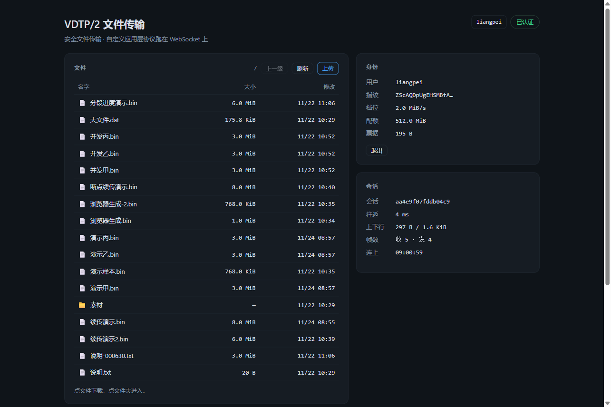

# VDTP/2

安全的文件传输 Web 应用：自定义应用层协议跑在 WebSocket 二进制帧上，浏览器就是客户端。



## 功能

- 公钥身份：浏览器 WebCrypto 生成 ECDSA P-256 密钥对，私钥不可导出、存 IndexedDB；登录对服务端 nonce 签名，不传口令。
- 分块传输：256 KiB 一块，块级 SHA-256、Merkle 根、全文摘要三重校验；4 MiB 一个 ACK 窗口。
- 断线续传：上传的 `.part` 与偏移落 SQLite，服务端重启后仍能接着传；下载留着已收缓冲区，重连后带偏移续。
- 多流并发：一条连接同时传多个文件，每个文件一条流。
- 按身份限速：令牌桶按档位，自由档 2 MiB/s、VIP 档 8 MiB/s，突发 256 KiB。
- 配额：按档位算用户目录占用，OPEN 时用已用量加声明大小预判。
- 连接上限：每 IP 16 条、每账号 4 条、每连接 8 条流、全局 512 条，超了回 DENIED 或直接关连接。
- 审计：认证结果、DENIED、上传完成与续传各记一条，落在 SQLite 的 `audit` 表。
- 安全面：nginx 只开 TLS 1.3 并做连接与请求限流，`deploy/acl.sh` 配目录 ACL，查询全参数化、用户名走白名单。

## 起服务

本地，两个终端。后端：

```bash
cd backend
python3 -m venv .venv
.venv/bin/pip install -i https://pypi.tuna.tsinghua.edu.cn/simple -r requirements.txt
.venv/bin/uvicorn app.main:app --host 127.0.0.1 --port 8000
```

前端：

```bash
cd frontend
npm install && npm run dev        # http://127.0.0.1:5173，/ws 与 /api 转到 8000
```

容器带 TLS，浏览器开 `https://127.0.0.1:8443`，自签证书需要点一次继续：

```bash
cd deploy
./gen_certs.sh
docker compose up -d --build
```

## 测试

```bash
cd backend
.venv/bin/python -m pytest -q                    # 50 项
.venv/bin/python tools/smoke.py                  # 注册、认证、列目录、上传下载、越权
.venv/bin/python tools/resume_smoke.py           # 传一半掐线，重连续传
.venv/bin/python tools/bench_rate.py 8 free      # 量一档的实际速率
.venv/bin/python tools/inject_demo.py            # 注入载荷
sudo ../deploy/acl.sh data                       # 目录 ACL 配置与自检
```

## 协议

16 字节定长头，大端：

| 字段 | 长度 | 含义 |
| --- | --- | --- |
| magic | 2 | 固定 `0x5654`，对不上直接断 |
| ver | 1 | 协议版本，当前 1 |
| type | 1 | 消息类型，1 到 19 |
| flags | 1 | bit0 分片末尾，其余保留 |
| rsv | 1 | 保留，发送方写 0 |
| stream | 2 | 流号，0 是控制流 |
| seq | 4 | 流内序号，从 1 递增 |
| length | 4 | 载荷长度，上限 1 MiB |

19 种消息分六组：握手、认证、目录、传输、恢复、其它；连接经 CONNECTED、CHALLENGED、AUTHED、CLOSED 四个状态，认证前只收 HELLO、AUTH_RESPONSE 与 PING。连接与流的上限、资源边界见协议文档。帧头位图、消息表、状态机与资源边界见 [docs/协议.md](docs/协议.md)。

## 目录

```
backend/
  app/          frame.py 帧编解码、auth.py 签名与票据、store.py SQLite 与钉根、
                transfer.py 上传下载与续传、bucket.py 令牌桶、limits.py 连接与流上限、
                main.py 端点
  tests/        单元测试
  tools/        smoke.py、resume_smoke.py、bench_rate.py、inject_demo.py、tier.py
frontend/
  src/          protocol.js、identity.js、merkle.js、transfer.js、App.vue
deploy/
  Dockerfile.backend / Dockerfile.frontend / docker-compose.yml
  nginx.conf（TLS 1.3、HSTS、连接与请求限流）、gen_certs.sh、acl.sh
docs/
  协议.md       协议规范
  login.png     README 用的界面截图
```

运行数据放在仓库外：`$XDG_DATA_HOME/vdtp`，缺省 `~/.local/share/vdtp`，用 `VDTP_DATA` 可以改。里面有 `vdtp.db`、`ticket.key` 与 `users/<用户名>/`。

开发证书在 `~/.config/vdtp/certs`（`gen_certs.sh` 生成，参数可改目录）；容器把数据放在 `vdtp-data` 卷里。两处都不进仓库。
